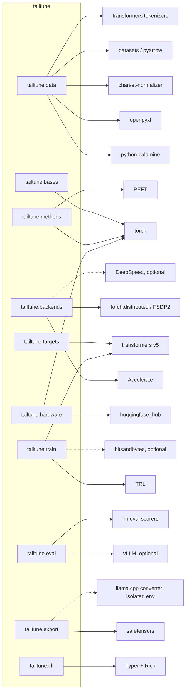

# 02. Architecture

**What this document decides:**

- tailtune is pure Python on PyTorch, shipped as one pure wheel. It has no Rust and no C++, and Triton only arrives later under the rules in D-04.
- tailtune is a thin layer. Transformers v5, PEFT, TRL, Accelerate and `datasets` do the training, and tailtune owns four things around them: the data pipeline, target resolution, the post-step constraint, and the retention report.
- Ten public modules, plus one private support package, sit in a strict layer order that CI checks. Method maths never sees a backend, and the CLI holds no logic.
- `tailtune train` and `tt.wrap` share one callback installer. `tailtune train` is "prepare, wrap, train, finalize".
- Every run writes a fully resolved `tailtune.yaml` that records where each value came from, plus a `lineage.json` that links runs into chains.
- Every exception maps to one of the README's exit codes. This document fills the gaps that table leaves and flags them for the owner.

Evidence labels are defined in the [plan index](README.md#evidence-labels). Code samples here are untested design proposals. Library versions were checked on 2026-11-07 and 2026-11-08.

## 1. Language and stack

### 1.1 Decision

| Layer | Choice | Rule |
|---|---|---|
| Language | Python 3.11+ | `requires-python = ">=3.11"`. torch 2.15, Transformers 5.22 and TRL 1.17 all require 3.11 [S](https://pypi.org/pypi/transformers/json) |
| Tensor runtime | PyTorch, floor 2.14, tested on 2.14 and 2.15 | The floor is 2.14 because Colab's snapshot lists `2.14.1+cu130` [S](https://github.com/googlecolab/backend-info/blob/main/pip-freeze.gpu.txt) |
| Model and training | Transformers v5, PEFT, TRL, Accelerate, `datasets` | No v4 compatibility layer (D-05) |
| Native code | None in the wheel | Rust and C++ excluded (D-04) |
| GPU kernels | None at v0.1. Triton later, per hot op | Each kernel needs a measured gain, a PyTorch fallback, an environment switch and a numerical-equivalence test (D-04) |
| Packaging | One pure wheel, functional extras | Details in [11](11-engineering-and-release.md) |

### 1.2 Rejected alternatives

| Alternative | Why it was rejected |
|---|---|
| **Rust core or Rust extensions** | Rust pays off where the whole value is speed at the file or tokenizer layer, and those tools already exist as dependencies: `tokenizers` is mostly Rust [S](https://api.github.com/repos/huggingface/tokenizers/languages), and so is `safetensors` [S](https://api.github.com/repos/huggingface/safetensors/languages). tailtune's hot path is GPU matrix work inside PyTorch, where Rust adds nothing. A native wheel needs a build matrix per platform, Python version and GPU, which one maintainer cannot sustain alongside new-model work [J] |
| **C++ or CUDA extensions** | Same build-matrix cost. Breadth does not need them: LlamaFactory reached 75,927 stars with no native code at all [S](https://api.github.com/repos/hiyouga/LLaMA-Factory/languages), and Axolotl carries only about 139k bytes of C++ [S](https://api.github.com/repos/axolotl-ai-cloud/axolotl/languages) |
| **Triton kernels first** | Speed is not the axis tailtune competes on (D-03). Unsloth's kernel directory represents years of work [S](https://api.github.com/repos/unslothai/unsloth/contents/unsloth/kernels), and its own headline gain on a recent model is now about 1.5x [S](https://unsloth.ai/docs/models/qwen3.8/train.md). Triton-style kernels target compute capability 8.0 and above, so the free T4 tier (Tier 1 reduced) would get the slow path anyway. Whether Inductor's Triton path works on T4 is unverified [U] |
| **Building on Unsloth** | A header grep at one commit found AGPL text in 126 of 206 Python files in `unsloth/` [S](https://github.com/unslothai/unsloth/tree/5f1d55556fd82f889abfe17a446c3b3a97a2f42b). The Apache-labelled `models/llama.py` imports AGPL kernels at module level [S](https://github.com/unslothai/unsloth/blob/5f1d55556fd82f889abfe17a446c3b3a97a2f42b/unsloth/models/llama.py). Its `unsloth_zoo` dependency is LGPL [S](https://pypi.org/pypi/unsloth_zoo/json). It also patches modeling code, and upstream breakage is one of its most-commented issue themes, for example [#1144](https://github.com/unslothai/unsloth/issues/1144) and [#3119](https://github.com/unslothai/unsloth/issues/3119). D-05 forbids the dependency |
| **Forking TRL or PEFT** | Forking would lose day-one support for new models and tuners, which is the main reason to build on them [J] |

### 1.3 Why a thin layer

Four reasons [J]:

1. **The method is a commodity.** OSF already ships in PEFT, so tailtune's value lies in the wrapper around the method, not in a training loop of its own.
2. **Upstream moves weekly.** Transformers has shipped 48 releases in 2026 so far, and TRL 32 [S](https://pypi.org/pypi/transformers/json). Every line that duplicates upstream behaviour becomes a line to re-check every week.
3. **The matrix must stay small.** Five methods across five backends is 25 combinations. Keeping method maths, communication and product surfaces in separate modules means each combination is tested through one narrow interface.
4. **Patching is the most fragile pattern.** tailtune never monkey-patches Transformers modeling code. Everything it adds goes through public extension points: `TrainerCallback`, PEFT configs, `from_pretrained` arguments and `save_pretrained`.

The cost is accepted: tailtune trains at Hugging Face baseline speed until profiling justifies a kernel.

## 2. External dependencies

### 2.1 Dependency diagram



Dashed lines are optional extras or isolated environments. Nothing in the diagram depends on Unsloth.

### 2.2 What each dependency is for

The version column gives the latest release seen in the research, not a pin. The tested ranges are set and published by [11](11-engineering-and-release.md).

| Package | Required or extra | Latest seen | Used for | Licence |
|---|---|---|---|---|
| `torch` | Required, plain dependency with no local version pin | 2.15.0 [S](https://pypi.org/pypi/torch/json) | Tensors, autocast, `torch.linalg.svd`, `torch.distributed`, FSDP2 | BSD-3-Clause [U] |
| `transformers` | Required, v5 only | 5.22.2 [S](https://pypi.org/pypi/transformers/json) | Loading, chat templates, `Trainer`, callbacks, saving | Apache-2.0 [U] |
| `peft` | Required | 0.21.2 [S](https://pypi.org/pypi/peft/json) | `lora` and `osf` tuners, merging | Apache-2.0 [S](https://api.github.com/repos/huggingface/peft) |
| `trl` | Required | 1.17.1 [S](https://pypi.org/pypi/trl/json) | `SFTTrainer` compatibility for `tt.wrap`, and later SDFT, DPO and GRPO (D-16) | Apache-2.0 [S](https://api.github.com/repos/huggingface/trl) |
| `accelerate` | Required | Not recorded | Device placement, DDP and FSDP2 plugins, `optimizer_step_was_skipped` | Apache-2.0 [U] |
| `datasets`, `pyarrow` | Required | 5.1.0; 26.0.1 [S](https://pypi.org/pypi/datasets/json) | Hub datasets, Arrow tables, Parquet freeze | Apache-2.0 [S](https://pypi.org/pypi/pyarrow/json) |
| `python-calamine` | Required | 0.9.1 [S](https://pypi.org/pypi/python-calamine/json) | Spreadsheet cell values | MIT [S](https://pypi.org/pypi/python-calamine/json) |
| `openpyxl` | Required | 3.1.5 [S](https://pypi.org/pypi/openpyxl/json) | Spreadsheet structure: merged ranges, hidden state, formula cache check | MIT [S](https://pypi.org/pypi/openpyxl/json) |
| `charset-normalizer` | Required | 3.5.2 [S](https://pypi.org/pypi/charset-normalizer/json) | Text encoding detection | MIT [S](https://pypi.org/pypi/charset-normalizer/json) |
| `huggingface_hub` | Required (also pulled in by Transformers) | Not recorded | Revision resolution, gated-model detection, tokens | Apache-2.0 [U] |
| `safetensors` | Required | Not recorded | The only weight format tailtune reads or writes (D-08) | Apache-2.0 [U] |
| `pydantic` (v2) | Required [J] | Not recorded | Config schema, validation, JSON Schema export for docs and editors | MIT [U] |
| `pyyaml` | Required [J] | Not recorded | `tailtune.yaml` and `mapping.yaml`, using safe load and dump only | MIT [U] |
| `typer`, `rich` | Required [J] | Not recorded | CLI parsing, terminal tables, prompts | MIT [U] |
| `bitsandbytes` | Extra `[bnb]` | Not recorded | 4-bit base for `lora`, optional 8-bit Adam | MIT [U] |
| `flash-attn` | Extra `[flash]` | Not recorded | FlashAttention 2 on Ampere and newer | BSD-3-Clause [U] |
| `vllm` | Extra `[vllm]` | 0.33.0 [S](https://pypi.org/pypi/vllm/json) | Fast generation for the report. Hugging Face generation is the fallback | Apache-2.0 [U] |
| `lm-eval` scorers | Required by `tailtune.eval` | Not recorded | Deterministic scorers reused, not reimplemented | MIT [U] |
| `docling` or `markitdown` | Extra `[docs]` | 2.148.0; 0.1.9 [S](https://pypi.org/pypi/markitdown/json) | PDF, DOCX and HTML to text, from Gate 4 onwards ([05](05-data-ingestion.md)) | MIT [S](https://pypi.org/pypi/docling/json) |
| `deepspeed` | Extra `[deepspeed]` | Not recorded | `zero2` reference backend, then `zero3` | Apache-2.0 [U] |
| llama.cpp converter | **Not a dependency.** Runs in an isolated environment | Pins `transformers==4.57.6`, `torch==2.11.0` [S](https://github.com/ggml-org/llama.cpp/blob/master/requirements/requirements-convert_hf_to_gguf.txt) | GGUF conversion ([10](10-export-and-deployment.md)) | MIT [U] |

Licences marked [U] were not confirmed in the research. The licence CI job (section 12) must confirm each one before the release that adds it.

### 2.3 Upstream APIs tailtune touches

This table is the upgrade-risk register. The weekly compatibility job ([11](11-engineering-and-release.md)) runs one test per row. A row marked "internal" uses an attribute that is not documented as public, so it carries the most risk.

| Library | API | Used by | Why | Risk note |
|---|---|---|---|---|
| Transformers | `AutoConfig.from_pretrained` | `hardware`, `targets` | Read shapes without downloading weights | Low |
| Transformers | `AutoModelForCausalLM.from_config` on the `meta` device | `hardware.estimate`, `targets.inspect` | Exact parameter names and shapes with no memory used | Composite models may need a different auto class ([06](06-models.md)) |
| Transformers | `from_pretrained(dtype=torch.float32, quantization_config=..., attn_implementation=..., revision=..., trust_remote_code=False, use_safetensors=True)` | `train.loader` | v5 defaults to `dtype="auto"`, so the dtype is always passed explicitly. v5 removed `load_in_4bit` in favour of `quantization_config` [S](https://github.com/huggingface/transformers/releases/tag/v5.0.0) | High: the loader was rebuilt around `WeightConverter` |
| Transformers | `get_decoder()`, `config.text_config`, `get_input_embeddings()`, `get_output_embeddings()`, `config.tie_word_embeddings` | `targets` | Scope to the text sub-model, find tied pairs [S](https://raw.githubusercontent.com/huggingface/transformers/main/MIGRATION_GUIDE_V5.md) | Medium |
| Transformers | `WeightConverter` key mapping (read only) | `targets`, `export.merged` | In-memory names can differ from checkpoint keys when v5 fuses at load [S](https://raw.githubusercontent.com/huggingface/transformers/main/MIGRATION_GUIDE_V5.md) | High: tailtune must record both key spaces |
| Transformers | `AutoTokenizer`, `apply_chat_template` | `data.render` | v5 returns `BatchEncoding` [S](https://github.com/huggingface/transformers/releases/tag/v5.0.0) | Medium |
| Transformers | `Trainer`, `TrainingArguments`, `processing_class` | `train` | Training loop. v5 replaced `tokenizer` with `processing_class` | Medium |
| Transformers | `TrainerCallback.on_optimizer_step`, `on_train_begin`, `on_save`, `on_train_end` | `train.callbacks` | Post-step projection (D-13). Order is `on_pre_optimizer_step`, `optimizer.step()`, `on_optimizer_step` [S](https://github.com/huggingface/transformers/blob/main/src/transformers/trainer.py#L1934-L1941) | High: the whole method depends on this order |
| Transformers | `trainer.add_callback`, `trainer.callback_handler.callbacks` | `train.wrap` | Install callbacks, and put the projection callback first | `callback_handler.callbacks` is internal |
| Transformers | `gradient_checkpointing_enable(gradient_checkpointing_kwargs={"use_reentrant": False})` | `train` | Reentrant checkpointing silently corrupts gradients under FSDP2 [S](https://github.com/huggingface/transformers/issues/50424) | Medium |
| Transformers | `save_pretrained` (safetensors only in v5) | `export.merged` | Merged output in the base's key names | Low |
| Transformers | `fsdp_config` with explicit `version: 2` | `backends.fsdp2` | Trainer defaults to 2 [S](https://github.com/huggingface/transformers/blob/main/src/transformers/training_args.py#L2826-L2827), Accelerate still defaults to 1 [S](https://huggingface.co/docs/accelerate/concept_guides/fsdp1_vs_fsdp2) | Always set explicitly |
| Accelerate | `trainer.accelerator.optimizer_step_was_skipped` | `train.callbacks` | Skip projection when the scaler dropped a step (D-13) | Medium |
| Accelerate | `DeepSpeedOptimizerWrapper.step()` is a no-op, and the real step runs in `backward` [S](https://github.com/huggingface/accelerate/blob/main/src/accelerate/utils/deepspeed.py#L264-L312) | `backends.zero2`, `zero3` | The reason the hook is `on_optimizer_step` and never a torch optimizer post-hook | High |
| Accelerate | `distributed_type`, `is_main_process`, FSDP and DeepSpeed plugin objects | `backends` | Detect the mode during `tt.wrap` | Medium |
| PEFT | `LoraConfig`, `get_peft_model` | `methods.lora` | `lora`, including on a 4-bit base | Low |
| PEFT | `OSFConfig(target_modules, effective_rank, rank_pattern)` [S](https://huggingface.co/docs/peft/en/package_reference/osf) | `methods.osf` | `osf` (D-10). `effective_rank` is the preserved rank, and `None` means 50% | Medium. Released v0.21.2 skips Conv1D targets silently [S](https://github.com/huggingface/peft/blob/v0.21.2/src/peft/tuners/osf/model.py), so tailtune rejects them itself (D-15) |
| PEFT | `merge_and_unload()` | `methods.*.finalize`, `export.merged` | Merged safetensors export | Whether OSF merges cleanly is a Gate 2 check. OSF does not support unmerging |
| TRL | `SFTTrainer` as a `Trainer` subclass [S](https://github.com/huggingface/trl/blob/v0.24.0/trl/trainer/sft_trainer.py#L481) | `train.wrap` | `tt.wrap(SFTTrainer)` | Unproven until tested (section 6) |
| TRL | SDFT, DPO, GRPO trainers | `train` (later) | D-16 modes | Not touched at v0.1 |
| torch | `torch.cuda.is_bf16_supported(including_emulation=False)` [S](https://github.com/pytorch/pytorch/blob/v2.15.0/torch/cuda/__init__.py#L244-L263) | `hardware.probe` | T4 reports True through emulation unless this argument is passed | Low |
| torch | `torch.linalg.svd` on CPU in fp32 [S](https://docs.pytorch.org/docs/2.15/generated/torch.linalg.svd.html) | `bases` | One SVD path everywhere (D-14) | Singular vectors differ across hardware, so tests use subspace distance |
| torch | `fully_shard`, `DTensor`, `MixedPrecisionPolicy(reduce_dtype=...)`, `reshard()` [S](https://docs.pytorch.org/docs/2.15/distributed.fsdp.fully_shard.html) | `backends.fsdp2` | Default sharded path (D-19) | torch 2.15 changed the `reduce_dtype=None` behaviour [S](https://github.com/pytorch/pytorch/releases/tag/v2.15.0) |
| DeepSpeed | `safe_get_full_fp32_param`, `safe_set_full_fp32_param` [S](https://deepspeed.readthedocs.io/en/latest/zero3.html) | `backends.zero2`, `zero3` | Read and write fp32 masters | Collective: every rank must call it, or the run hangs |
| `datasets` | `load_dataset` (Hub id, config, split, revision), `Dataset.from_dict`, `to_parquet` | `data` | Hub sources and freezing. `datasets` has no spreadsheet loader [S](https://github.com/huggingface/datasets/blob/a1269ca9dbb6e0858a9c375e8982329a3fcc84af/src/datasets/packaged_modules/__init__.py) | Low |

## 3. Package layout

`src/` layout (D-07). Each subpackage's `__init__.py` re-exports that module's public names and nothing else. Files marked "later" are created at the gate named, not before.

```text
src/tailtune/
  __init__.py              Public surface: read, plan, train, wrap, evaluate, inspect, estimate, doctor,
                           Dataset, Run, Plan, RetentionReport, errors. Binds functions after importing subpackages
  __main__.py              `python -m tailtune` -> cli.main
  py.typed                 Marks the package as typed
  _version.py              Version string, written by the build
  _core/                   Private support layer. Imports nothing else from tailtune
    __init__.py
    errors.py              Exception hierarchy, error codes (TT-xxxx), exit-code mapping
    config.py              Pydantic schema for tailtune.yaml: TailtuneConfig and its sections
    resolve.py             Layered config resolution and the provenance map
    rundir.py              RunDir: allocate runs/run-NNN, path helpers, atomic writes, event log
    hashing.py             sha256 of files, canonical JSON, tensors and templates
    protocols.py           Cross-layer protocols: WeightView, RouteCandidate, StepStats
    routes.py              RouteId enum shared by hardware and methods
    hub.py                 Revision resolution, gated or token checks, offline mode
    console.py             Rich console, quiet and JSON modes, TTY detection, confirm()
    versions.py            Capture dependency versions, compare with the tested ranges
    lazy.py                Lazy import helper, so `tailtune --help` never imports torch
  data/
    __init__.py            read, Dataset, DataReport, Mapping
    dataset.py             Dataset class (user-facing, see 04)
    pipeline.py            sniff -> read -> normalize -> detect -> map -> render -> validate -> freeze
    sniff.py               Magic-byte detection, extension second
    readers/
      __init__.py          Reader registry
      base.py              Reader protocol, RawTable
      spreadsheet.py       xlsx, xlsm, xls, xlsb, ods: calamine values plus an openpyxl structure pass
      delimited.py         csv, tsv, with encoding detection
      jsonlines.py         json, jsonl
      columnar.py          parquet, arrow
      hub.py               Hugging Face dataset id with config, split and revision
      memory.py            datasets.Dataset, pandas DataFrame, list of dicts
      documents.py         later (Gate 4): pdf, docx, html through the [docs] extra
    normalize.py           Merges, header row, empty rows and columns, escapes
    detect.py              Ordered schema rules and alias lists, with confidence and reason
    mapping.py             Mapping model; the {col} and [[optional {col}]] template language
    render.py              Chat-template render, tokenize with no added special tokens, build labels
    validate.py            Checks, blocking or warning
    report.py              DataReport: terminal table and data_report.json
    freeze.py              data.parquet, mapping.yaml, content hashes
  targets/
    __init__.py            Role, TargetGroup, TargetSet, Coverage, resolve_targets, inspect
    roles.py               Role enum
    registry.py            RoleMap type and register_role_map()
    maps/
      __init__.py          Imports every built-in map
      qwen3.py             One file per model_type family (launch models per D-20)
      llama.py
      gemma4.py
      granite.py
    structural.py          Fallback: walk named_parameters, treat [E,m,n] as E matrices
    resolve.py             resolve_targets(): registry first, fallback second
    coverage.py            Protected, free and frozen shares; the floor check
    keys.py                In-memory name to checkpoint key mapping
    report.py              TargetReport for `tailtune inspect` and targets.json
  bases/
    __init__.py            Basis, BasisKey, BasisSet, BasisStore, load_or_compute
    svd.py                 fp32 CPU SVD, head and tail forms
    store.py               On-disk cache in safetensors, keyed by BasisKey
    checks.py              Orthonormality, subspace distance
  methods/
    __init__.py            Method, MethodSpec, get_method, register_method
    base.py                Protocol and MethodSpec dataclass
    registry.py            Name to class
    lora.py                PEFT LoRA, optional 4-bit base
    sst.py                 SST (Chavan et al., 2026): projection maths only
    osf.py                 PEFT OSF tuner adapter
    full.py                Baseline: unconstrained full tuning
    freeze.py              Baseline: train a named subset only
    tail_lora.py           later (by v0.3), experimental
    repair.py              later (v0.3), DG-Hard, pending verification
  backends/
    __init__.py            Backend, get_backend, detect_backend
    base.py                Backend protocol
    single.py              Plain tensors
    ddp.py                 Plain tensors per rank, plus a drift check
    fsdp2.py               later (Gate 3): DTensor Shard(0), local multiply plus all-reduce
    zero2.py               Reference only (D-19)
    zero3.py               later, on demand
  hardware/
    __init__.py            probe, estimate, choose, HardwareInfo, Estimate
    probe.py               GPUs, real bf16, driver, host RAM, WSL2 memory cap, tier
    estimate.py            Memory formula per route (owned by 07)
    autoselect.py          method="auto" and model="auto" rules
    tiers.py               D-17 tier table as data
  train/
    __init__.py            Must stay light: no torch import at module level
    api.py                 plan(), train(), wrap(), evaluate_run()
    plan.py                Plan dataclass: everything the confirmation prompt shows
    orchestrator.py        The end-to-end sequence in section 5
    loader.py              Model and tokenizer loading with the dtype rules (D-12)
    precision.py           Autocast and scaler policy, fp32 masters
    trainer_factory.py     Builds transformers.Trainer from the config and frozen data
    collate.py             Collator for pre-tokenized rows with labels
    callbacks.py           ProjectionCallback, LineageCallback, ReportCallback, MetricsCallback
    install.py             install_callbacks(): shared by train and wrap
    run.py                 Run class
    lineage.py             Lineage schema, chain resolution, lineage.json writing
    launch.py              Spawns DDP or FSDP2 workers that read the frozen run directory
    worker.py              Entry point for spawned ranks
  eval/
    __init__.py            evaluate, RetentionReport, Benchmark, register_benchmark
    suite.py               Suites ("fast", later "full"), item lists with hashes
    benchmarks/
      __init__.py
      drift.py             KL or cross-entropy to the base on neutral text
      ifeval.py
      humaneval.py         Sandboxed, or marked "not run"
      gsm8k.py
      mmlu_pro.py
      mgsm.py
      refusal.py           XSTest and StrongREJECT
      user_set.py          User-supplied retention sets
    generate.py            vLLM or Hugging Face generation, same items and scorers
    cache.py               Base-model result cache
    stats.py               Paired bootstrap, McNemar exact, Holm correction
    gates.py               --max-regression parsing and checks
    report.py              FORGETTING_REPORT.md and forgetting_report.json
  export/
    __init__.py            export_merged, export_gguf, write_modelfile, verify_template, launch
    merged.py              Merge, cast, save in the base's checkpoint key names
    isolated_env.py        Creates and caches the converter environment
    gguf.py                Calls the converter in that environment
    modelfile.py           Ollama Modelfile with the stored template
    verify.py              Template hash check, logit round trip
    serve.py               `tailtune run`: Ollama when available, else a Transformers REPL
  cli/
    __init__.py            main(): exit-code mapping, Ctrl-C handling
    app.py                 Typer app, global flags
    doctor.py              One file per command. Each parses, calls one API function and renders
    estimate.py
    inspect.py
    train.py
    eval.py
    export.py
    run.py
    repair.py              later (v0.3)
    render.py              Presentation helpers: tables, colours, JSON output
  kernels/                 later, only under D-04
    __init__.py            Registry, TAILTUNE_TRITON switch, PyTorch fallbacks
```

## 4. Modules

### 4.1 The dependency rule

Modules sit in layers. A module may import only from strictly lower layers. Two modules in the same layer never import each other.

| Layer | Modules | May import |
|---|---|---|
| 0 | `tailtune._core` | Third-party packages only |
| 1 | `tailtune.data`, `tailtune.targets` | Layer 0 |
| 2 | `tailtune.bases`, `tailtune.hardware` | Layers 0 and 1 (in practice `targets`, not `data`) |
| 3 | `tailtune.methods`, `tailtune.backends` | Layers 0 to 2 |
| 4 | `tailtune.eval`, `tailtune.export` | Layers 0 to 3 |
| 5 | `tailtune.train` | Layers 0 to 4 |
| 6 | `tailtune.cli` | The public names of layers 1 to 5 |
| Root | `tailtune/__init__.py` | Public names only, loaded lazily |

Two consequences matter:

- **Methods and backends never import each other.** They meet through the `WeightView` protocol in `_core.protocols`. Backends produce views, methods consume them, and `train` passes one to the other.
- **`hardware` never imports `methods`.** `method="auto"` receives a list of `RouteCandidate` records built by `train` from the method registry.

**Enforcement** [J]:

1. An `import-linter` "layers" contract, plus "independence" contracts for each same-layer pair, run as a required CI job.
2. A Ruff banned-API rule for `unsloth`, `unsloth_zoo`, `fitz` and `pymupdf`, and for `torch.load` and `pickle.load` anywhere under `src/` (D-08).
3. A Ruff banned-module-level-import rule that keeps `torch`, `transformers`, `peft`, `trl` and `vllm` out of module scope in `cli/` and in every subpackage `__init__.py`.
4. A test that imports `tailtune.cli` and asserts `"torch" not in sys.modules`, so `tailtune --help` stays fast.

### 4.2 `tailtune._core` (private support)

**Responsibility.** Errors, config schema and resolution, run directories, hashing, cross-layer protocols, Hub access and console I/O.

**Key signatures** (untested design proposal):

```python
# _core/protocols.py
class WeightView(Protocol):
    name: str                  # in-memory parameter name
    local: torch.Tensor        # fp32 master rows this rank owns (all rows except under FSDP2)
    rows: slice                # which rows of the full matrix `local` holds
    def reduce_sum(self, t: torch.Tensor) -> torch.Tensor: ...   # identity unless rows are sharded
    def commit(self) -> None: ...                                # write back; no-op if `local` aliases the master

@dataclass(frozen=True)
class RouteCandidate:
    method: str                # "sst", "osf", "lora", ...
    route: RouteId             # memory route that hardware.estimate prices
    strength: int              # ordering for method="auto"; provisional until Gate 1
    requires: frozenset[str]   # e.g. {"bitsandbytes"} or {"real_fp32_targets"}

# _core/rundir.py
class RunDir:
    @classmethod
    def allocate(cls, root: Path, name: str | None = None) -> "RunDir": ...
    path: Path
    def file(self, rel: str) -> Path: ...
    def write_json(self, rel: str, obj: Any) -> str: ...   # atomic; returns sha256
    def write_yaml(self, rel: str, obj: Any) -> str: ...
    def event(self, kind: str, **fields: Any) -> None: ... # appends to logs/events.jsonl
```

**Must not:** import any other tailtune module, import torch at module level (only `protocols.py` refers to it, and only under `TYPE_CHECKING`), or perform network access except in `hub.py`.

**Imported by:** every module.

### 4.3 `tailtune.data`

**Responsibility.** The single ingestion pipeline behind every surface (D-21): `sniff → read → normalize → detect → map → render → validate → freeze`. It produces the validation report. Stage behaviour is specified in [05](05-data-ingestion.md).

**Public types and functions:**

```python
def read(source: str | os.PathLike | "datasets.Dataset" | "pandas.DataFrame" | Sequence[Mapping[str, Any]],
         *, sheet: str | Sequence[str] | None = None, header_row: int | None = None,
         user: str | None = None, assistant: str | None = None, system: str | None = None,
         text: str | None = None, mapping: str | os.PathLike | Mapping[str, Any] | None = None,
         format: Literal["auto", "messages", "sharegpt", "alpaca", "prompt_completion",
                         "preference", "text"] = "auto",
         split: str | None = None, revision: str | None = None,
         model: str | None = None, max_seq_length: int | None = None,
         interactive: bool | None = None) -> Dataset: ...

def run_pipeline(spec: SourceSpec, *, tokenizer: "PreTrainedTokenizerBase | None",
                 options: DataOptions) -> PipelineResult: ...
def freeze(result: PipelineResult, run_dir: RunDir) -> FrozenData: ...

@dataclass(frozen=True)
class FrozenData:
    parquet: Path; parquet_sha256: str; source_sha256: str
    mapping_path: Path; mapping_sha256: str
    report_path: Path; template_sha256: str | None; rows: int
```

**Inputs and outputs.** In: a path, Hub id or in-memory table, an optional mapping, and an optional tokenizer. Out: a `Dataset`. When frozen, it writes `data.parquet` (messages, plus `input_ids` and `labels` once rendered), `mapping.yaml` and `data_report.json`.

**Rule that protects training:** the token ids written by `render` are the ids the trainer consumes. No later stage re-tokenizes. That way the BOS, EOS and label checks in `validate` apply to exactly what is trained.

**Must not:** load model weights, call any language model, guess silently on an ambiguous mapping when non-interactive, modify the source file, or skip validation.

**Imported by:** `train`, `eval` (to read user retention sets), `cli`, the package root.

### 4.4 `tailtune.targets`

**Responsibility.** Decide which parameters a method constrains, trains freely or freezes. It holds the role registry with its structural fallback, computes coverage, and powers `tailtune inspect`. Rules are in [06](06-models.md).

```python
class Role(StrEnum):
    ATTN_Q = "attn_q"; ATTN_K = "attn_k"; ATTN_V = "attn_v"; ATTN_O = "attn_o"; ATTN_FUSED = "attn_fused"
    MLP_GATE = "mlp_gate"; MLP_UP = "mlp_up"; MLP_DOWN = "mlp_down"; MLP_FUSED = "mlp_fused"
    EXPERT = "expert"; ROUTER = "router"; EMBEDDING = "embedding"; HEAD = "head"
    NORM = "norm"; CONV = "conv"; MTP = "mtp"; OTHER = "other"

@dataclass(frozen=True)
class TargetGroup:
    name: str                          # in-memory parameter name
    checkpoint_keys: tuple[str, ...]   # may differ under WeightConverter fusion
    role: Role
    shape: tuple[int, ...]
    n_matrices: int                    # E for an [E, m, n] tensor, else 1
    state: Literal["protected", "free", "frozen"]
    reason: str                        # "role map qwen3", "structural fallback", "router frozen by default", ...
    free_dims: int | None              # free directions at the chosen r, per matrix

@dataclass(frozen=True)
class TargetSet:
    model_type: str
    resolver: Literal["registry", "structural"]
    groups: tuple[TargetGroup, ...]
    coverage: "Coverage"
    sha256: str                        # hash of the canonical JSON in targets.json

def resolve_targets(model: torch.nn.Module, config: "PretrainedConfig", *,
                    policy: TargetPolicy, r: float | None) -> TargetSet: ...
def inspect(model: str, *, revision: str | None = None, method: str = "sst",
            r: float | None = None, policy: TargetPolicy | None = None) -> TargetReport: ...
def register_role_map(model_type: str, role_map: RoleMap) -> None: ...
```

**Inputs and outputs.** In: a model, which may be on the `meta` device, and its config. Out: a `TargetSet`, serialized as `targets.json`.

**Must not:** modify the model, compute an SVD, choose a method, or raise for low coverage. It reports coverage, and the caller decides whether to refuse.

**Imported by:** `bases`, `hardware`, `methods`, `backends`, `export`, `train`, `cli`.

### 4.5 `tailtune.bases`

**Responsibility.** Offline SVD in fp32 on one CPU path everywhere. It hashes, caches and checks bases (D-14). Bases are keyed by parameter name, because objects captured before distributed wrapping go stale ([08](08-distributed.md)).

```python
@dataclass(frozen=True)
class BasisKey:
    model_revision: str; param_name: str; shape: tuple[int, ...]; r: float
    form: Literal["head", "tail"]; svd_impl: str; torch_version: str

def compute_basis(weight: torch.Tensor, *, r: float, form: Literal["head", "tail"]) -> Basis: ...
def load_or_compute(weights: Iterable[tuple[str, torch.Tensor]], *, revision: str, r: float,
                    store: BasisStore, workers: int = 1) -> BasisSet: ...
def subspace_distance(a: torch.Tensor, b: torch.Tensor) -> float: ...
def check_orthonormal(q: torch.Tensor, *, tol: float) -> None: ...
```

**Inputs and outputs.** In: named fp32 tensors. Out: a `BasisSet` with a combined `sha256`, cached under `~/.cache/tailtune/bases/` by default.

**Must not:** run SVD on an accelerator by default, download or upload bases (Hub sharing waits on licence review, D-14), or know about trainers or backends.

**Imported by:** `methods`, `train`.

### 4.6 `tailtune.methods`

**Responsibility.** `lora`, `sst`, `osf`, `full` and `freeze`, later `tail-lora`, behind one interface (D-10). Each method states its exact variant and rank (D-11). The algorithms are in [03](03-methods.md).

```python
@dataclass(frozen=True)
class MethodSpec:
    name: str                       # "sst"
    variant: str                    # e.g. "SST (Chavan et al., 2026), fixed basis, two-sided applied-step projection"
    status: Literal["stable", "baseline", "experimental"]
    route: RouteId
    needs_fp32_targets: bool        # D-12
    needs_bases: bool
    acts_post_step: bool            # needs the projection callback
    rank_param: str | None          # "r", "effective_rank", "lora.rank"
    strength: int                   # method="auto" ordering, provisional until Gate 1

class Method(Protocol):
    spec: ClassVar[MethodSpec]
    def prepare(self, model: "PreTrainedModel", targets: TargetSet, cfg: MethodConfig) -> "PreTrainedModel": ...
    def bind(self, targets: TargetSet, bases: BasisSet | None, refs: "RefStore | None") -> None: ...
    def post_step(self, view: WeightView) -> StepStats | None: ...   # called once per real optimizer step
    def finalize(self, model: "PreTrainedModel") -> "PreTrainedModel": ...   # merge adapters, drop wrappers

def get_method(name: str) -> type[Method]: ...
def register_method(cls: type[Method]) -> None: ...
```

For example, the SST post-step uses only `view.local`, `view.rows` and `view.reduce_sum`. On one GPU, `reduce_sum` is the identity. Under FSDP2, it is an all-reduce of a small coefficient matrix. The maths is written once.

**Must not:** call `torch.distributed` directly, import `backends`, read config files, load models, or register gradient hooks when `torch.compile` is on (section 11).

**Imported by:** `train`.

### 4.7 `tailtune.backends`

**Responsibility.** Read and write weights for each training mode: `single`, `ddp`, `fsdp2`, `zero2` and `zero3` (D-19). Each backend turns its parameter form into `WeightView`s. Mode details are in [08](08-distributed.md).

```python
class Backend(Protocol):
    name: ClassVar[Literal["single", "ddp", "fsdp2", "zero2", "zero3"]]
    def attach(self, trainer: "Trainer") -> None: ...        # after accelerator.prepare
    def views(self, names: Sequence[str]) -> Iterator[WeightView]: ...   # one at a time, bounded memory
    def is_main_process(self) -> bool: ...
    def barrier(self) -> None: ...
    def check_drift(self, names: Sequence[str]) -> float: ...   # ddp: max abs difference across ranks

def detect_backend(trainer: "Trainer") -> Backend: ...   # raises UnsupportedBackendError for FSDP1, torch_xla
```

**Must not:** implement method maths, decide whether to skip a step, or gather a full weight when a local view suffices.

**Imported by:** `train`.

### 4.8 `tailtune.hardware`

**Responsibility.** Probe the machine, estimate memory per route before any weights load (D-18), classify the tier (D-17), and run the `method="auto"` and `model="auto"` rules. The formula and the tier table belong to [07](07-hardware.md).

```python
@dataclass(frozen=True)
class HardwareInfo:
    platform: str; accelerator: Literal["cuda", "rocm", "mps", "xpu", "cpu"]
    gpus: tuple[GpuInfo, ...]; host_ram_gib: float; wsl2_ram_cap_gib: float | None
    torch: str; cuda: str | None; driver: str | None; real_bf16: bool; tier: Tier

def probe() -> HardwareInfo: ...
def estimate(model: str | "PretrainedConfig", *, routes: Sequence[RouteId] | None = None,
             seq_len: int = 1024, micro_batch: int = 1, nproc: int = 1,
             r: float | None = None, hw: HardwareInfo | None = None) -> Estimate: ...
def choose(candidates: Sequence[RouteCandidate], est: Estimate, hw: HardwareInfo) -> AutoChoice: ...

@dataclass(frozen=True)
class AutoChoice:
    method: str; route: RouteId; rule_id: str; reason: str   # `reason` is the one printed line
```

**Must not:** download weights (config and tokenizer files only), allocate more than a probe tensor on a GPU, or import `methods`.

**Imported by:** `eval` (choosing a generation backend), `train`, `cli`.

### 4.9 `tailtune.train`

**Responsibility.** Orchestration, the `Trainer` and `SFTTrainer` wrapper, the `Run` object and run lineage.

```python
def plan(data: Dataset | str | os.PathLike, *, model: str = "auto", method: str = "auto",
         config: str | os.PathLike | Mapping[str, Any] | None = None,
         overrides: Mapping[str, Any] | None = None, from_run: "str | os.PathLike | Run | None" = None,
         run_dir: str | os.PathLike | None = None) -> Plan: ...
def train(data: "Dataset | Plan | str | os.PathLike", *, model: str = "auto", method: str = "auto",
          r: float | None = None, **kwargs: Any) -> Run: ...         # full keyword list in 04
def wrap(trainer: "Trainer", *, method: str = "auto", r: float | None = None, **kwargs: Any) -> "Trainer": ...
def install_callbacks(trainer: "Trainer", ctx: RunContext) -> None: ...   # shared by train and wrap
```

**Must not:** implement method maths or data stages, write outside the run directory and the documented caches, or call `torch.load`.

**Imported by:** `cli`, the package root.

### 4.10 `tailtune.eval`

**Responsibility.** The retention report. It caches base results, runs the fast suite, computes paired statistics, and applies regression gates (D-22). It accepts any merged model from any trainer. The report contents are in [09](09-evaluation.md).

```python
def evaluate(base: str | os.PathLike, candidate: str | os.PathLike, *, suite: str = "fast",
             retention_set: str | os.PathLike | None = None,
             max_regression: Mapping[str, float] | None = None,
             parent: str | os.PathLike | None = None, out: str | os.PathLike | None = None,
             backend: Literal["auto", "vllm", "hf"] = "auto") -> RetentionReport: ...
```

**Must not:** train, call a cloud judge without opt-in, run model-generated code outside a sandbox, use leading-slice subsets, or depend on `train` or lineage. It receives paths, not runs.

**Imported by:** `train`, `cli`, the package root.

### 4.11 `tailtune.export`

**Responsibility.** Merged safetensors in the base's key names, GGUF built in an isolated environment, the Ollama Modelfile, the template-hash check, and the `tailtune run` launcher (D-23). Details are in [10](10-export-and-deployment.md).

```python
def export_merged(model: "PreTrainedModel", tokenizer: Any, out: Path, *,
                  key_space: KeySpace, template_sha256: str, dtype: "torch.dtype") -> Path: ...
def export_gguf(model_dir: Path, out: Path, *, outtype: str = "q8_0") -> Path: ...
def write_modelfile(gguf: Path, model_dir: Path, out: Path) -> Path: ...
def verify_template(model_dir: Path, expected_sha256: str) -> None: ...   # raises TemplateMismatchError
def launch(target: Path, *, engine: Literal["auto", "ollama", "transformers"] = "auto",
           prompt: str | None = None) -> int: ...
```

**Must not:** install converter requirements into the training environment, rename tensors, or write pickle files.

**Imported by:** `train`, `cli`.

### 4.12 `tailtune.cli`

**Responsibility.** Commands only (section 4 of [04](04-api-and-ux.md)). Each command does four things: parse arguments into the same keyword arguments the Python API takes, call exactly one public function, render the result, and map exceptions to exit codes.

**Must not:** make decisions, import torch at module scope, or read data files.

**Imported by:** nothing except `__main__.py` and the console-script entry point.

### 4.13 The package root and a name collision

`tt.train` is a function, while `tailtune.train` is a subpackage. Python sets a subpackage as an attribute of its parent when the subpackage is first imported. So if `tailtune.train` were imported lazily after `__init__.py` had bound the function, `tt.train` would silently turn into the module.

The rule:

- `tailtune/__init__.py` imports `tailtune.train`, `tailtune.eval` and `tailtune.export` eagerly first, then binds the public functions. Those three `__init__.py` files must not import torch, so `import tailtune` stays cheap.
- The public evaluation function is `tt.evaluate`, never `tt.eval`, which would collide with the module and with the builtin.
- A test imports every subpackage and submodule in turn, then asserts that `callable(tt.train)` holds and that `tt.train is tailtune.train.api.train`.

## 5. Sequence of a `tailtune train` run

`tailtune train faq.xlsx` and `tt.train(tt.read("faq.xlsx"))` run the same steps. The CLI adds the confirmation at step 9. The Python API never prompts.

| # | Step | Module | Writes | Can refuse with (exit code) |
|---|---|---|---|---|
| 1 | Parse arguments into API keyword arguments | `cli` | Nothing | Usage error (1, see section 10) |
| 2 | Resolve config layers (section 7), without `auto` values yet | `_core.resolve` | Nothing | `ConfigError` (5) |
| 3 | Allocate `runs/run-NNN/` with an exclusive `mkdir` | `_core.rundir` | Directory, `logs/events.jsonl` | Run directory exists and `--name` was given (1) |
| 4 | Probe hardware | `hardware.probe` | Event | No usable accelerator and no `--allow-cpu` (4) |
| 5 | Resolve the model: id, revision to a commit hash, access check. Download config and tokenizer files only | `_core.hub` | Event | Gated model or missing token (1). Remote code required (1). No safetensors weights (1) |
| 6 | Data pipeline through `validate`, using the tokenizer | `data` | `mapping.yaml` and `data_report.json`, **written even on failure** | Blocking check (2). Ambiguous mapping or sheet under `--yes` (2) |
| 7 | Build the model on `meta`, resolve targets, compute coverage | `targets` | `targets.json` | Coverage below floor (4). Conv1D or quantized trainable target (4) |
| 8 | Estimate every route with real sequence lengths, then resolve `method=auto` and `model=auto` | `hardware` | Event | Nothing fits, or the requested method does not fit (4) |
| 9 | Show the plan: data summary, mapping preview, samples, model, method line, estimate. Ask `[Y/n]` | `cli` via `Plan` | Nothing | Declined, or no TTY without `--yes` (1) |
| 10 | Freeze data. Write the resolved config with provenance | `data.freeze`, `_core` | `data.parquet`, `tailtune.yaml` | Disk full (1) |
| 11 | Base evaluation, or a cache hit, run before training weights occupy the GPU | `eval` | Cache entry | Eval backend broken (1). `--no-report` skips this step and records that it did |
| 12 | Load weights with the method's dtype rules (D-12), `trust_remote_code=False`, safetensors only | `train.loader` | Event | Low-precision trainable target (4) |
| 13 | Re-resolve targets on the real model and compare with step 7 | `targets` | Nothing | Mismatch is an internal bug (1) |
| 14 | Bases for `sst`: cache hit or offline fp32 CPU SVD, then the orthonormality check | `bases` | Cache entry | Check fails (1) |
| 15 | Apply the method (`prepare`), build the `Trainer`, call `install_callbacks` | `methods`, `train` | `checkpoints/` (proposed, see below) | None expected |
| 16 | `trainer.train()`. Projection runs at every real optimizer step | `train`, `methods`, `backends` | `logs/train.jsonl`, checkpoints | Out of memory despite the estimate (1, see TT-H005 in [04](04-api-and-ux.md)) |
| 17 | `finalize`: merge, cast to the base's storage dtype, save in checkpoint key names with tokenizer, template and template hash | `methods`, `export.merged` | `model/` | Key mapping failure (1) |
| 18 | Post-training evaluation against the base. For a chained run, also against the parent | `eval` | `FORGETTING_REPORT.md`, `forgetting_report.json` | Gate failure (3), but only after step 20 |
| 19 | Default exports: GGUF in the isolated environment, plus the Modelfile | `export` | Inside `model/`, layout set by [10](10-export-and-deployment.md) | Converter failure (1). Earlier artifacts stay |
| 20 | Write `lineage.json` last, with every hash. Print the summary | `train.lineage` | `lineage.json` | None |

An absent `lineage.json` means the run is incomplete. `tailtune train --resume runs/run-001` restarts from the last checkpoint using the stored `tailtune.yaml` and `data.parquet`.

**Proposed additions to the run directory.** The README table lists the contract files. This design adds three paths, which need the owner's approval before they are recorded in the README:

| Path | Contents | Kept after success |
|---|---|---|
| `logs/events.jsonl` | One JSON line per step: start, end, refusal, warnings | Yes |
| `logs/train.jsonl` | Loss, learning rate, projected step norm, skipped steps | Yes |
| `checkpoints/` | Trainer checkpoints for `--resume` | The last one only, by default |

The layout inside `model/`, including where GGUF and the Modelfile go, is owned by [10](10-export-and-deployment.md).

**Multi-GPU runs.** Steps 1 to 10 run once, in the CLI process. For `ddp` and later `fsdp2`, step 11 onwards runs in workers that `train.launch` spawns through `accelerate launch`, as in [08](08-distributed.md). Each worker reads `tailtune.yaml` and `data.parquet` from the run directory, so there is one confirmation and one frozen copy of the inputs. Only rank 0 writes run files.

## 6. Sequence for `tt.wrap(trainer, ...)`

`tt.wrap` adds tailtune to training code the user already has. It returns the same trainer object, now carrying callbacks and a `tailtune_run` attribute that holds a `Run`.

```python
# Untested design proposal
trainer = SFTTrainer(model=model, args=args, train_dataset=ds, processing_class=tok)
trainer = tt.wrap(trainer, method="sst", r=0.99)   # README form
trainer.train()
print(trainer.tailtune_run.retention_report())
```

### 6.1 What `wrap` requires of the trainer

| Requirement | Check | If violated |
|---|---|---|
| A `transformers.Trainer` or a subclass, on Transformers 5.x | `isinstance` and a version check | `WrapError` |
| Not already wrapped | `_tailtune_wrapped` marker | `WrapError` |
| Training not started | `trainer.state.global_step == 0`, optimizer not yet stepped | `WrapError`: "wrap before calling train()" |
| For `sst`, `osf`, `full` and `freeze`: the tensors the optimizer updates are fp32 (D-12) | dtype of each target, or of its master copy under ZeRO | `LowPrecisionTargetError` (exit 4 in the CLI) |
| For `sst`: no quantized targets, no Conv1D targets | Resolver | `TargetTypeError` |
| Coverage at or above the floor | Resolver | `CoverageBelowFloorError` |
| Supported backend: single, DDP, FSDP2 version 2, or ZeRO-2 | `detect_backend` | `UnsupportedBackendError` for FSDP1 and, until built, ZeRO-3 |
| Under FSDP2: `use_reentrant=False` | `trainer.args.gradient_checkpointing_kwargs` | Forced to `False`, with a warning naming [#50424](https://github.com/huggingface/transformers/issues/50424) |

### 6.2 What `method="auto"` means inside `wrap`

The model is already loaded, so `auto` cannot pick a route. Inside `wrap` it reads the model's state:

| Model state | `auto` resolves to | Effect |
|---|---|---|
| A PEFT model with LoRA adapters | `lora` | Report, lineage and `inspect` only. Training is unchanged |
| A PEFT model with OSF | `osf` | Same, plus OSF coverage recorded |
| A dense model with fp32 targets that fits the estimate | `sst` with `r=0.99` | Projection callback installed |
| A dense model with bf16 or fp16 targets | Refuses | The message offers two fixes: reload with `dtype=torch.float32`, or drop `tt.wrap`, train as before, and run `tailtune eval <base> <model>` afterwards for the report alone. `method="full"` is not a fix, because D-12 requires fp32 for it too |

`wrap` never performs model surgery. Applying `OSFConfig` changes parameters and optimizer groups, so it must happen before the trainer is built. `tt.train` does this, and `wrap` only detects it.

### 6.3 Steps

1. Run the checks in 6.1. Resolve `method`.
2. Resolve targets on the unwrapped model (`trainer.model`, or its base model for PEFT). Write `targets.json` to the run directory. The default is `runs/run-NNN/`, or `run_dir=` if given.
3. For `sst`: compute or load bases from the cache, keyed by parameter name and model revision. Record the reference weights `W_ref`, on host or GPU per the estimate. The revision comes from `model.config._name_or_path` and the Hub, or from `base_model=` when the model was loaded locally. If it cannot be resolved, lineage records `"revision": null` and a warning.
4. Build a `RunContext` and call `install_callbacks(trainer, ctx)`, the same function `tt.train` uses. It installs:
   - `ProjectionCallback`, inserted at position 0 so that it runs before any user callback that reads weights at `on_optimizer_step`, such as an exponential moving average.
     - `on_train_begin`: attach the backend after `accelerator.prepare`, re-resolve parameters by name, and verify fp32 masters.
     - `on_optimizer_step`: if `trainer.accelerator.optimizer_step_was_skipped`, record a skip and return. Otherwise call `method.post_step(view)` for every target view, and log the projected step norm.
     - `on_save`: write the bases hash and, for refresh only, `W_ref` beside the checkpoint.
   - `LineageCallback`: writes `tailtune.yaml` at train begin and `lineage.json` at train end.
   - `ReportCallback`: at train end, on the main process, saves a merged copy to `model/`, then calls `tailtune.eval.evaluate`.
   - `MetricsCallback`: appends to `logs/train.jsonl`.
5. Set the marker and the `tailtune_run` attribute. Return the trainer.

The callbacks hold a reference to the trainer, because `on_optimizer_step` needs `trainer.accelerator`. The reference is weak, to avoid keeping a finished trainer alive.

### 6.4 What stays unproven until TRL is tested

No published test runs SST or OSF through a TRL trainer, and 01 lists "drop-in wrapper" as a goal until one passes. The specific unknowns:

| Unknown | Why it matters | Test that settles it (Gate 2) |
|---|---|---|
| `SFTTrainer` builds a PEFT model inside `__init__` when `peft_config=` is passed | `wrap` must see the final model | Wrap an `SFTTrainer` built with `peft_config`, and assert the resolved targets |
| Callback order under `SFTTrainer` | Projection must run first | Assert position 0 after `wrap` and after `train()` starts |
| Gradient accumulation fires `on_optimizer_step` once per optimizer step, not per micro-batch | `K` counts optimizer steps | Count callback calls at accumulation 4 |
| DPO with a reference model | The reference must be excluded from targets | Later, with D-16 |
| GRPO weight sync to a generation engine | The sync must happen after projection | Later, with D-16 |

The Accelerate behaviour under DeepSpeed is sourced: the real step runs inside `backward`, so `on_optimizer_step` follows it [S](https://github.com/huggingface/accelerate/blob/main/src/accelerate/utils/deepspeed.py#L264-L312). Every TRL claim stays unproven until the tests above pass.

## 7. Config resolution

### 7.1 Layers, lowest to highest

| Order | Source | Provenance tag | Example |
|---|---|---|---|
| 1 | Schema defaults | `default` | `training.max_grad_norm: 1.0` |
| 2 | Method defaults | `default:<method>` | `training.learning_rate` for `sst` |
| 3 | Named preset | `preset:<name>` | `sst_paper` (D-15) |
| 4 | Config file (`--config`, or `config=` in Python) | `file:<path>` | `runs/run-001/tailtune.yaml` |
| 5 | Mapping file (`--mapping`) | `file:<path>` | `data.mapping` |
| 6 | Environment variables, for paths and switches only | `env:<VAR>` | `TAILTUNE_RUNS_DIR` |
| 7 | CLI flags and `--set key=value`, or Python keyword arguments | `cli` or `python` | `--method lora` |
| 8 | Detection from the data or the machine, only where the value is still `auto` | `detected:<what>` | `data.sheet`, `training.precision` |
| 9 | Auto rules, only where the value is still `auto` | `auto:<rule-id>` | `method.name: auto:A4` |

Higher layers win. `auto` is a value, not a missing value: steps 8 and 9 replace it only where the merged result is still literally `auto`. So an explicit user value is never overridden by a hardware rule.

Hyperparameters cannot be set through environment variables [J]. That rule keeps runs reproducible from the files in the run directory.

### 7.2 Validation

The schema is strict:

- An unknown key is a `ConfigError` with a "did you mean" suggestion.
- A wrong type is a `ConfigError` naming the key and its source layer.
- A `schema_version` newer than the installed tailtune is a `ConfigError`. An older one is migrated, with a note in `logs/events.jsonl`.

### 7.3 How `tailtune.yaml` records every applied default

The run's `tailtune.yaml` is a full dump of the resolved schema: every key, including ones the user never set. A top-level `provenance` map records where each value came from.

```yaml
# Written by tailtune 0.1.0 for run-001. Every value this run used.
# Reuse: tailtune train --config runs/run-001/tailtune.yaml
schema_version: 1
model:
  id: Qwen/Qwen3-4B
  revision: <40-character commit hash>
method:
  name: lora
  lora: {rank: 16, alpha: 16, dropout: 0.0, base_quant: 4bit}
training:
  learning_rate: 0.0002
  max_grad_norm: 1.0
  # ...every remaining key...
provenance:
  model.id: auto:M1
  model.revision: detected:hub
  method.name: auto:A4
  method.lora.base_quant: auto:A4
  training.learning_rate: default:lora
  training.max_grad_norm: default
  data.sheet: detected:only-data-sheet
```

The design is illustrative, and the full key list is in [04](04-api-and-ux.md). When a resolved file is reused as `--config`, every value counts as `file:` and the `provenance` block is ignored on input. Because `auto` has already been replaced by concrete values, the rerun repeats the original choices. On weaker hardware it then refuses with exit code 4, rather than silently choosing a different method.

## 8. Lineage

### 8.1 `lineage.json` schema

The README lists the required contents: base commit, method variant string, r, `K`, bases hash, coverage, data hash, template hash, applied and skipped optimizer steps, dependency versions and previous run. This schema includes all of them and adds what chains and audits need.

```json
{
  "schema_version": 1,
  "run_id": "run-002",
  "status": "complete",
  "created_at": "2026-11-08T10:12:03Z",
  "finished_at": "2026-11-08T10:41:55Z",
  "tailtune_version": "0.1.0",
  "base": {
    "source": "run",
    "model_id": "Qwen/Qwen3-4B",
    "revision": "<commit of the root Hub model>",
    "model_sha256": "<manifest hash of the starting weights>",
    "key_space_sha256": "<hash of the checkpoint key list>"
  },
  "method": {"name": "sst", "variant": "SST (Chavan et al., 2026), fixed basis", "r": 0.99, "K": null, "preset": null},
  "targets": {"sha256": "<targets.json>", "resolver": "registry",
              "coverage": {"protected": 0.93, "free": 0.0, "frozen": 0.07}, "floor": 0.9},
  "bases": {"sha256": "<BasisSet>", "form": "tail", "svd": {"device": "cpu", "dtype": "float32"}},
  "data": {"parquet_sha256": "...", "source_sha256": "...", "mapping_sha256": "...", "rows": 1201},
  "template": {"sha256": "...", "source": "tokenizer"},
  "config_sha256": "...",
  "environment": {"python": "3.12.7", "torch": "2.15.0+cu130", "transformers": "5.22.2", "trl": "1.17.1",
                  "peft": "0.21.2", "accelerate": "...", "datasets": "5.1.0", "platform": "linux-x86_64",
                  "accelerator": "cuda", "driver": "580.xx", "gpus": [{"name": "...", "count": 1, "vram_gib": 96}]},
  "backend": {"name": "single", "nproc": 1},
  "training": {"applied_steps": 223, "skipped_steps": 2, "seed": 42,
               "projected_step_norm": {"mean": 1.2e-4, "max": 9.8e-4}, "wall_seconds": 1792},
  "retention": {"report_sha256": "...", "against": ["parent", "root"],
                "worst": {"benchmark": "ifeval", "delta": -3.1, "ci95": 2.7, "bin": "Minor"},
                "gates": {"passed": true, "failed": []}},
  "model": {"sha256": "<manifest hash>", "files": {"model-00001-of-00002.safetensors": "..."}},
  "previous_run": {"run_id": "run-001", "path": "../run-001", "lineage_sha256": "...", "model_sha256": "..."},
  "chain": {"depth": 2, "root_run_id": "run-001", "ancestors": ["run-001"]}
}
```

The values are illustrative. Rules:

- `status` is one of `complete`, `regressed` (the gate failed but all artifacts exist) or `failed`. A run with no `lineage.json` is incomplete.
- Hashes are sha256 over file bytes. `model.sha256` and `base.model_sha256` hash a sorted manifest of per-file hashes.
- `retention` is `null` when the report was switched off. The summary and the report both say so.
- `previous_run.path` is relative, so a `runs/` folder can be moved as a whole.

### 8.2 How chains work

`tailtune train new.xlsx --from runs/run-001` (or `run.continue_with(data)` in Python) starts a chained run:

1. **Verify the parent.** Its `lineage.json` must exist with status `complete` or `regressed`. Its `model/` manifest must match `model.sha256`. A mismatch is `LineageError` (1), because the parent's weights changed after the fact.
2. **The parent's model is the base.** `base.source` is `"run"`, and `base.model_sha256` is the parent's model hash. The root Hub id and revision are carried forward unchanged.
3. **Bases are recomputed** from the parent's weights, because SST's `W_ref` is the starting weights of each task ([03](03-methods.md)).
4. **The template must match** the parent's template hash. Otherwise the run refuses unless `--allow-template-change` is passed, and the report states the change.
5. **The report compares against both the parent and the root.** Comparing only against the parent would hide cumulative loss. The base cache is keyed by model hash, so the root's results are reused.
6. **Depth warning.** SST's sequential experiments cover only two- and three-stage chains [S](https://arxiv.org/html/2610.22293). At depth 4 and beyond, the summary prints that retention across long chains is unmeasured.

If the parent's directory is missing (for example, on another machine), `--from` also accepts a model path plus `--parent-lineage FILE`. Hashes still verify the link.

## 9. Extension points

Each extension needs: code in the named place, a registry entry, tests, a docs page, and a "runs" or "retention benchmarked" label where it applies (D-02).

| Extension | Where | Steps |
|---|---|---|
| **Add a method** | `methods/<name>.py` | 1. Write a `MethodSpec` with an exact `variant` string. 2. Implement `prepare`, `bind`, `post_step` and `finalize`. 3. `register_method`. 4. Add tests: frozen-subspace invariant after N steps, skip on `optimizer_step_was_skipped`, merge round trip, memory route priced in [07](07-hardware.md). 5. Set `strength` only after a Gate 1 style measurement, otherwise leave it out of `auto`. 6. Add a docs page naming the variant and rank (D-11) |
| **Add a model role map** | `targets/maps/<family>.py` | 1. Read the checkpoint's safetensors header and config, not just module names. 2. Map each parameter pattern to a `Role`, scoped to the text sub-model. 3. Freeze routers, conv kernels and `mtp` by default (D-15). 4. Add a tiny-model snapshot test of `inspect` output. 5. Record both key spaces. 6. Label the model "runs" until benchmarked |
| **Add a backend** | `backends/<mode>.py` | 1. Implement `Backend.views` yielding `WeightView`s. 2. Make `reduce_sum` correct for the row layout. 3. Add tests: same invariants as `single` on CPU with gloo, a "hook ran after the real step" check, and a drift check where ranks hold copies. 4. Add a memory route. 5. Add a CI job ([08](08-distributed.md), [11](11-engineering-and-release.md)) |
| **Add a benchmark** | `eval/benchmarks/<name>.py` | 1. Commit item ids and a hash of the list. 2. Download benchmark text at run time, and never redistribute gated or share-alike sets. 3. Use a deterministic scorer, reused where possible. 4. Emit per-item results for paired statistics. 5. Record the licence and gating status ([09](09-evaluation.md)) |
| **Add a data reader** | `data/readers/<kind>.py` | 1. Implement `sniff(head: bytes, path) -> float` and `read(spec, options) -> RawTable`, with every cell as text. 2. Register it. 3. Add fixture files, including the failure cases in [05](05-data-ingestion.md). 4. Put heavy libraries behind an extra, and never PyMuPDF |

Registration is in-tree only before v1.0 [J]. Third-party plugins through entry points wait for the stable schema at v1.0, because a public plugin API freezes these protocols.

## 10. Error model

### 10.1 Hierarchy and exit codes

```text
TailtuneError                          exit 1 unless a subclass says otherwise
├── ConfigError                        5   unknown key, bad type or value, bad schema version (README code 5)
├── UsageError                         5   CLI parse errors (remapped, see below)
├── EvalInputMismatchError             5   base and candidate are not a comparable pair
├── CancelledError                     1   declined at the prompt (no TTY without --yes is a UsageError, 5)
├── ModelAccessError                   4   pre-flight refusal under policy
│   ├── GatedModelError                4
│   ├── MissingTokenError              4
│   ├── RemoteCodeRequiredError        4
│   └── UnsafeWeightsError             4   only pickle weights available
├── DataError                          2
│   ├── UnsupportedFormatError         2
│   ├── AmbiguousMappingError          2
│   └── DataValidationError            2   carries the DataReport
├── RefusedError                       4
│   ├── DoesNotFitError                4
│   ├── CoverageBelowFloorError        4
│   ├── TargetTypeError                4   Conv1D or quantized trainable target
│   ├── LowPrecisionTargetError        4
│   ├── TemplateRefusedError           4   chat-template mismatch at training start, run or eval
│   └── NoAcceleratorError             4
├── RegressionGateError                3   carries the RetentionReport
├── WrapError                          1   Python API only
├── UnsupportedBackendError            4   pre-flight refusal (README code 4)
├── LineageError                       1
├── ExportError                        1
│   ├── TemplateMismatchError          1   export's own self-check only (TT-E003)
│   └── ConverterError                 1
└── InternalError                      1   invariant broken; always asks for a bug report
```

Every error carries a stable code (`TT-D012` and so on), a one-line message, a cause, a fix and a docs anchor. The full catalogue is in [04](04-api-and-ux.md).

### 10.2 Rules

- `cli.main` catches `TailtuneError` and prints the code, message, cause and fix to stderr. It exits with the class's code. Any other exception becomes `InternalError` (1), with the traceback written to `logs/events.jsonl` and shown only with `--verbose`.
- **Typer and Click exit with 2 on usage errors, which collides with code 2.** `cli.main` catches the Click usage exception and re-raises it as `UsageError` (5).
- Ctrl-C exits with 130, the shell convention. This is outside the README table.
- The Python API raises the same classes. `DataValidationError` carries `.report`, and `RegressionGateError` carries `.report` and `.run`.
- Warnings use `warnings.warn` with a `TailtuneWarning` category and the same codes, so users can filter them.

**Resolved in the plan index on 2026-11-08:**

- Code 5 covers configuration and usage errors, including a missing terminal without `--yes`.
- Code 4 covers every pre-flight refusal, including target type, low precision, no accelerator and model access.
- Code 1 covers internal errors, export failures, out of memory and a declined confirmation.
- Ctrl-C exits 130.

## 11. Compatibility with performance features

Projection happens after the optimizer step, on real fp32 weights, outside the forward and backward graphs. Most speed features never see it. **Nothing in this table has been tested.** The "Basis" column says whether each row is reasoned from docs or sourced.

| Feature | tailtune default | Interaction with post-step projection | Basis | Test that proves it, and gate |
|---|---|---|---|---|
| SDPA attention | On (`attn_implementation="sdpa"`) | None: attention does not touch weights between steps | Reasoned | Logit equality against eager on a tiny model, Gate 2 |
| FlashAttention 2 | Opt-in through `[flash]`, Ampere and newer | None | Reasoned | Same test with `flash_attention_2`, Gate 2, Tier 1 GPU job |
| Fused AdamW | On for CUDA (`adamw_torch_fused`) [J]. The default on CUDA is foreach, which uses more peak memory [S](https://docs.pytorch.org/docs/2.15/generated/torch.optim.AdamW.html) | None: it supports fp32, and projection edits weights after it | Reasoned | Frozen-subspace invariant with fused and foreach, Gate 2 |
| 8-bit Adam | Opt-in through `[bnb]`. Not on MPS | None for projection. Sharding with DTensor is unverified | Reasoned | Invariant test, Gate 3 for FSDP2 |
| Gradient checkpointing | On, always with `use_reentrant=False` | None for projection. Reentrant mode under FSDP2 silently corrupts gradients [S](https://github.com/huggingface/transformers/issues/50424) | Sourced issue | Gradient equality on 2-rank gloo FSDP2, Gate 3 |
| `torch.compile` | Off at v0.1 [J] | In-place edits between steps fall outside the compiled graph. Backward hooks, which PEFT OSF uses, cause graph breaks and change timing [S](https://github.com/pytorch/pytorch/blob/v2.15.0/docs/source/user_guide/torch_compiler/torch.compiler_nn_module.md) | Reasoned | Invariant test with compile on for `sst`. `osf` plus compile is refused until a test passes, Gate 4 |
| Liger-style patched kernels | Not integrated | A patched forward can read `lm_head` directly and bypass a PEFT wrapper [S](https://github.com/linkedin/Liger-Kernel/blob/main/src/liger_kernel/transformers/model/llama.py#L158-L162) | Sourced code | Not planned before v1.0 |
| Triton kernels (D-04) | None until profiled | Each kernel is opt-out through `TAILTUNE_TRITON=0` and has a PyTorch fallback | Rule | A numerical-equivalence test on CPU-compatible fixtures, plus a measured gain, per kernel |
| fp16 autocast on T4 | Automatic when real bf16 is absent | fp32 masters with a scaler. The scaler skips early steps, and projection skips with it | Reasoned | Skip-count test, Kaggle T4 weekly job, Gate 2 |

## 12. Licence boundaries

| Category | Policy | Examples |
|---|---|---|
| Required dependencies | Permissive only: Apache-2.0, MIT, BSD, PSF, ISC | Section 2.2 |
| Optional extras | Permissive only. Never AGPL or "AGPL or commercial" | PyMuPDF is excluded, because it is dual AGPL and commercial [S](https://pypi.org/pypi/pymupdf/json) |
| Forbidden dependencies | Unsloth and `unsloth_zoo` (D-05) | AGPL and LGPL files, as shown in section 1.2 |
| Separate processes | Allowed when isolated and documented | llama.cpp converter (MIT [U]), run in its own environment |
| Reimplemented from papers | Allowed. Cite the paper, copy no code | SST from the CC BY 4.0 paper, because its repo has no licence (D-06) [S](https://github.com/Arnav0400/SST) |
| Copied code | Only from files verified Apache-2.0 or MIT at a pinned commit, with attribution | Unsloth's `chat_templates.py` carries an Apache header at one commit [S](https://github.com/unslothai/unsloth/blob/5f1d55556fd82f889abfe17a446c3b3a97a2f42b/unsloth/chat_templates.py). Re-verify on every copy |
| Never vendored | Unlicensed, AGPL and LGPL code | The SST repo, Unsloth's AGPL kernels and Studio, `unsloth_zoo`, Unsloth notebooks (LGPL [S](https://api.github.com/repos/unslothai/notebooks)), Unsloth's Kaggle CI workflow, which has an AGPL header |
| Mixed-licence sources | Keep both notices until upstream resolves the conflict | mini_trainer: Apache in `LICENSE.md` [S](https://github.com/Red-Hat-AI-Innovation-Team/mini_trainer/blob/fd5b552/LICENSE.md), MIT in package metadata |

**CI checks** [J]:

1. **Dependency licences.** A script resolves the full set from `uv.lock`, including every extra, and reads each package's licence metadata. It fails on any GPL family, AGPL, SSPL, "commercial" or unknown licence that is not on a reviewed allowlist. The allowlist records a reason for each entry.
2. **Headers.** Every file under `src/` and `tests/` carries an `SPDX-License-Identifier: Apache-2.0` header. A file copied from elsewhere also carries its original notice, and is listed in `THIRD_PARTY_NOTICES.md` with its source URL and commit.
3. **Forbidden text.** A grep fails on "GNU Affero", "GNU Lesser" or "GNU General Public" anywhere under `src/`.
4. **Forbidden imports.** The Ruff rule from section 4.1.

None of this is legal advice. Take legal advice before relying on the licence readings in this section.

## Implementation checklist

**Gate 0 Claim**
- [ ] Create the `src/tailtune/` skeleton with `_core`, `hardware` and `cli` only.
- [ ] Add the `import-linter` contracts, Ruff banned-import rules and the "torch not imported by the CLI" test.
- [ ] Build `_core.errors` with the exit-code mapping, including the Click usage-error remap.
- [ ] Build `hardware.probe` (real bf16 through `including_emulation=False`, WSL2 memory cap) and `hardware.estimate` from config on the `meta` device.
- [ ] Add the licence CI script and the SPDX header check.

**Gate 1 Verify**
- [ ] Record measured peak memory against `estimate` routes, and change route labels from [C] to [M] where measured.
- [ ] Set `MethodSpec.strength` for `sst` and `osf` from the comparison at equal r.

**Gate 2 v0.1 Door**
- [ ] `data` pipeline, freezing token ids so that trained tokens equal validated tokens.
- [ ] `targets` with role maps for the launch architectures, `keys.py` and `targets.json`.
- [ ] `bases` with the CPU fp32 SVD, cache and subspace-distance tests.
- [ ] `methods`: `lora`, `sst`, `osf`, `full` and `freeze`, behind `MethodSpec`.
- [ ] `backends`: `single` and `ddp`, with a drift check.
- [ ] `train`: orchestrator, loader dtype rules, `install_callbacks`, `wrap`, `Run`, `lineage.json`, chains with `--from`.
- [ ] `eval` and `export` integrated at steps 11, 18 and 19.
- [ ] Package-root binding order and the `callable(tt.train)` test.
- [ ] Upgrade-risk tests: one per row of the section 2.3 table, in the weekly compatibility job.
- [ ] TRL wrap tests from section 6.4. Claim `SFTTrainer` support only after they pass.

**Gate 3 v0.2 Proof**
- [ ] `backends.fsdp2` with explicit `version: 2` and `reduce_dtype`, and forced `use_reentrant=False`.
- [ ] Gradient-checkpointing equality test on 2-rank gloo FSDP2.

**Gate 4 v0.3 Reach**
- [ ] Refresh (`K`): `W_ref` and bases saved on `on_save` for resume.
- [ ] `methods.tail_lora` (experimental) and `methods.repair` (if DG-Hard verifies).
- [ ] `torch.compile` invariant test, and lift the `osf` plus compile refusal only if it passes.
- [ ] `data.readers.documents` behind `[docs]`.

**Gate 5 v1.0**
- [ ] Freeze `schema_version` 1 and the extension protocols. Decide on entry-point plugins.
- [ ] `backends.zero3` if demanded.

## Acceptance tests

| # | Test | Passes when |
|---|---|---|
| A1 | Layer contracts | `lint-imports` passes. A deliberate `methods → backends` import in a fixture branch fails CI |
| A2 | CLI import weight | `python -c "import tailtune.cli, sys; assert 'torch' not in sys.modules"` succeeds |
| A3 | Name binding | After importing every submodule, `callable(tt.train)` holds and `tt.train is tailtune.train.api.train` |
| A4 | Shared implementation | `tailtune train fixture.xlsx --yes` and `tt.train(tt.read("fixture.xlsx"))` with the same seed produce byte-identical `tailtune.yaml` (apart from `provenance` tags `cli` and `python`), `data.parquet` and `targets.json` |
| A5 | Run directory | A successful run contains every README file. A refused run contains `mapping.yaml` and `data_report.json` but no `lineage.json` |
| A6 | Refusal order | Each refusal in section 5 triggers on a fixture before any weights load (steps 1 to 9), except the precision check, which triggers at step 12 |
| A7 | Exit codes | Each error class maps to its code. A Click usage error exits 5, not 2. Ctrl-C exits 130 |
| A8 | Hook placement | On `single`, `ddp` (2 ranks, gloo) and `zero2`, `post_step` runs after the weights change and once per optimizer step at accumulation 4 |
| A9 | Skipped steps | With a forced scaler skip, projection does not run, and the frozen-subspace content stays unchanged |
| A10 | Provenance | Every key in `tailtune.yaml` has a provenance entry. Reusing the file reproduces the choices, and on weaker hardware it exits 4 rather than re-choosing |
| A11 | Lineage chain | A two-run chain verifies the parent hash, reports against the parent and the root, and fails with `LineageError` if one byte of the parent's model changes |
| A12 | Wrap checks | `wrap` refuses on a bf16 model with `method="sst"`, on a second wrap, and after `train()` has started |
| A13 | Licence gate | Adding a fixture dependency with an AGPL licence fails the licence job |

## Open questions

1. *(Resolved in the plan index: exit codes 0 to 5 plus 130 cover every error class.)*
2. **Run directory additions.** Are `logs/` and `checkpoints/` acceptable additions to the README contract, and should `checkpoints/` be deleted after success by default?
3. **`SFTTrainer` internally.** This design trains through `transformers.Trainer`, with tailtune's own tokenization, so that validated tokens equal trained tokens. Whether TRL's `SFTTrainer` can consume pre-tokenized rows with labels unchanged was not verified. If it can, switching would reduce code.
4. **vLLM's torch pin.** If the `[vllm]` extra pins a torch version outside the tested range, evaluation may need the same isolated-environment approach as GGUF export.
5. **OSF merging.** PEFT's OSF does not support unmerging. Whether `merge_and_unload` produces clean merged weights for every launch model needs a Gate 2 test.
6. **Callback position.** Inserting at position 0 relies on `callback_handler.callbacks`, which is internal to Transformers. A public ordering mechanism would be safer if one exists.
7. **Chains across machines.** Hash-verified links work without the parent directory, but the base cache keyed by model hash cannot be shared until bases may be published (D-14).
